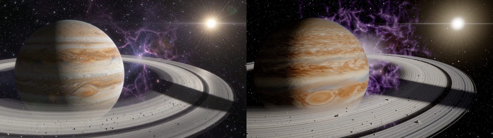
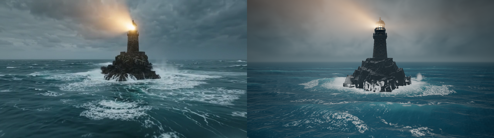
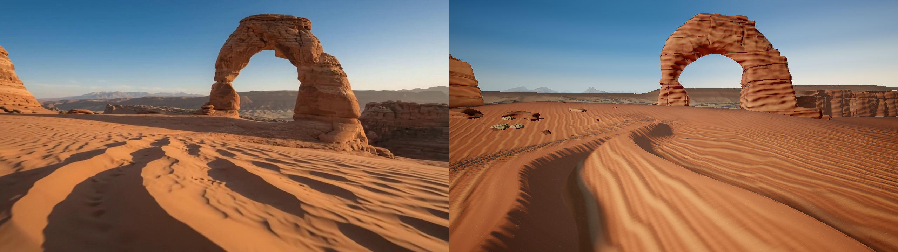

# Gemini Video 2 GLSL

**Live Demo:** [https://gemini-shader-test-carbon.web.app](https://gemini-shader-test-carbon.web.app)

A fun, unattended experiment showing what **Gemini 4 Carbon** (running on high) can build end-to-end from a single specification ([docs/spec.md](docs/spec.md)):

1. **Generate a 5-scene film** (Space, Forest, Ocean, Desert, Cavern) at 720p 16:9 using [`gemini-api`](https://github.com/google-gemini/gemini-api-cli) and cut the clips into a seamless 25-second looping film with cross-dissolves.
2. **Recreate the entire film as one procedural GLSL shader** — decomposing the five scenes across modular specialist shader parts (`shaders/parts/*.glsl` → `shaders/film.glsl` → `public/shader.glsl`) and inspecting the generated video frames directly to match framing, camera trajectories, palettes, lighting, multi-tier procedural noise, and dissolves in a single paste-ready Shadertoy fragment shader (`mainImage`, zero textures, zero baked data, real-time 360° mouse orbit in every scene), built with [`shader-art-coding` (`gokayfem/shader-skills`)](https://github.com/gokayfem/shader-skills).
3. **Compare both live in the browser** with a minimal zero-dependency Side-by-Side and draggable Wipe player locked to the exact same 25-second timeline.

---

## Credits

- **Model:** **Gemini 4 Carbon** (running on high)
- **Tools:**
  - **[`gemini-api`](https://github.com/google-gemini/gemini-api-cli)** — CLI used to generate the five 720p 16:9 source video scenes.
  - **[`shader-art-coding` (`gokayfem/shader-skills`)](https://github.com/gokayfem/shader-skills)** (MIT) — provided the procedural shader workflow, WebGL2/Shadertoy lint and `glslangValidator` check harness, dependency-pruning bundler (`glsl_tools.py`), reference templates (`raymarch-sdf.glsl`, `ocean.glsl`, `terrain.glsl`, `volumetric-clouds.glsl`), and bundled GLSL library modules (`common`, `hash`, `noise`, `pattern`, `sdf3d`, `sdf2d`, `operators`, `domain`, `architecture`, `raymarch`, `intersect`, `camera`, `shading`, `water`, `color`, `tonemap`, `volume`, `atmosphere`, `post`, `debug`). `LICENSE` and `CREDITS.md` are preserved in `shader-skills/`.

---

## Film vs. Procedural GLSL Stills (`1280×720` each)

Each pair shows the frame from `public/film.mp4` on the left and the live procedural GLSL shader frame at the exact same timestamp (`1280×720`, `AA = 1`, `DEBUG_MODE = 0`) on the right.

### Scene I — Space (`t = 02.00s`)


### Scene II — Forest (`t = 07.00s`)


### Scene III — Ocean (`t = 12.00s`)


### Scene IV — Desert (`t = 17.00s`)


### Scene V — Cavern (`t = 22.00s`)


---

## Modular Multi-Part Architecture

To build rich three-tier procedural detail across every subject (trees, ferns, logs, waves, masonry, dunes, arches, karst walls, and crystal clusters) without cross-scene interference, the shader is authored in 11 modular parts under `shaders/parts/` and assembled into `shaders/film.glsl`:

| Part | Responsibility |
| :--- | :--- |
| `00_common.glsl` | Timeline & exposure controls, material IDs, shared light/landmark anchors, `applyOrbit`, `marchBounded`, `fastShadow` |
| `01_space.glsl` | **Scene I (Space):** Turbulent gas-giant zonal jets & vortex wakes, icy ring divisions & moonlets, cosmic web, starfield & sun |
| `02a_forest_trees.glsl` | **Scene II (Forest — Trees & Canopy):** Flared coast redwoods, buttress roots, braided Sequoia bark, celadon lichen & conifer boughs |
| `02b_forest_floor.glsl` | **Scene II (Forest — Floor & Volumetrics):** Two-tier comb-serrated sword ferns, `Oxalis` carpet, mossy nurse logs, shelf fungi, twigs & sunbeams |
| `03a_ocean_waves.glsl` | **Scene III (Ocean — Sea & Sky):** Storm cumulus deck, 24-wave dispersive swells, foreground breaker, curl-warped foam filigree & surf plumes |
| `03b_ocean_lighthouse.glsl` | **Scene III (Ocean — Stack & Lighthouse):** Columnar basalt sea stack, gullied cascades, ashlar tower, iron galleries, Fresnel lens & rotating beam |
| `04a_desert_dunes.glsl` | **Scene IV (Desert — Dunes & Sky):** S-curved dune brinks, Y-branching aeolian ripples, quartz micro-sparkle, slickrock cobbles & scrub tufts |
| `04b_desert_arch.glsl` | **Scene IV (Desert — Arch & Badlands):** Chiseled Entrada sandstone arch, talus slabs, stratified left butte, creviced canyon rim & distant mesas |
| `05a_cavern_rock.glsl` | **Scene V (Cavern — Karst Vault):** Receding limestone arches, planar-cleaved wet slate slabs, flowstone draperies & two-tier fluted stalactites |
| `05b_cavern_crystals.glsl` | **Scene V (Cavern — Crystals & River):** Chisel-pointed hexagonal amethyst/cyan clusters, druzy beds, fissure veins, drip rings & Fresnel river reflections |
| `99_main.glsl` | AgX tonemapping, `DEBUG_MODE` (`0..6`) & `AA` dispatcher, `ZERO`-looped 25s cross-dissolve timeline (`sampleFilm`) & `mainImage` |

---

## How to Run

Requires Node.js (no `npm install` — zero dependencies) and Python 3:

```bash
# Start the byte-range-capable local server at http://localhost:3000
npm start

# Assemble shaders/parts/*.glsl -> shaders/film.glsl and bundle into public/shader.glsl
npm run bundle

# Lint and compile-check shaders/film.glsl and public/shader.glsl
npm run check

# Assemble + bundle + check together ( plus standalone per-scene test mode via scripts/assemble_shader.py --scene <name> )
npm run build
```

Open `http://localhost:3000` (or set `PORT=8080 npm start`).

- **Side-by-Side / Wipe:** Switch between dual 16:9 panes (Film left, GLSL right) and a stacked 16:9 frame with a draggable wipe divider.
- **Transport & Scene Jumps:** Play/Pause (`Space`), scrub across `00:00.0 – 00:25.0`, or click **I Space** … **V Cavern** (or any of the five **Original Videos** cards) to jump straight to a scene.
- **Mouse Orbit:** Drag on the shader to orbit its 3D camera around any scene; click **Reset Orbit** to return to the film-locked camera path.

---

## Scene-by-Scene Notes

- **I · Space (`00s – 05s`):** Matches planet framing (`uv ≈ (-0.72, 0.04)`), multi-stage domain-warped cream/ochre/rust zonal belts with Kelvin-Helmholtz chevrons and convective plumes, Great Southern Oval Vortex with eyewall collar and trailing wakes, sleek ring perspective with Encke/Cassini divisions and right-side planet shadow penumbra, sunlit foreground icy moonlets, filamentous violet cosmic web with dark dust lanes, pinpoint PCG starfield, and horizontal solar flare. *Simplified:* Separates planet key-light direction from the ring-shadow cylinder to match the film's art direction, and shades ring moonlets analytically on the ring plane rather than raymarching 3D boulders.
- **II · Forest (`05s – 10s`):** Matches low forward corridor glide between flared coast redwoods with snaking buttress root spurs, deep braided Sequoia bark canyons, matte pale-sage crustose lichen, layered feathery backlit conifer boughs, ~40° volumetric morning sunbeams, two-tier Western sword-fern rosettes with central rachis and comb-serrated pinnae leaflets, obcordate redwood sorrel (`Oxalis`) carpet, split-bark mossy nurse logs with polypore shelf fungi, and crooked deadwood twigs. *Simplified:* Uses dual-chart cylindrical coordinates + post-hit normal relief for fine bark fibers, polar-sector SDF fronds for fern clumps, and multi-plane parallax bough fans for the upper canopy.
- **III · Ocean (`10s – 15s`):** Matches exact horizon (`uv.y = +0.119`), tilted hexagonal columnar basalt sea stack (`sdHexPrism` + stepped reefs) with gullied whitewater cascades, Smeaton-battered staggered ashlar stone lighthouse, iron gallery railings, glowing multi-ring Fresnel optic (`uv ≈ (0.13, 0.59)`), rotating bi-valve volumetric searchlight beam, 24-wave dispersive storm-teal swells with Toksvig/LEAN GGX filtering, right-foreground pitching breaker, curl-warped cellular sea-froth filigree, and billowing surf spray plumes. *Simplified:* Uses a single-valued heightfield with analytic crest curvature and layered 3D spray veils rather than overturning multi-valued 3D wave tubes.
- **IV · Desert (`15s – 20s`):** Matches sweeping S-curved asymmetric sand dune brinks casting scalloped golden-hour shadow ribbons, bifurcating (Y-branching) aeolian wind ripples damped on leeward slip-faces, distance-filtered quartz micro-sparkle, slickrock cobbles and desert scrub tufts, chiseled Delicate-Arch sandstone bridge with stacked talus slabs, cross-bedding laminae and warped rock joints, stratified left sandstone butte, creviced right canyon rim, Canyonlands badlands, stepped mesas, and distant snow-dusted peaks. *Simplified:* Evaluates bifurcating ripples and quartz sparkle via distance-filtered normal/albedo perturbation over a $C^2$-continuous dune heightfield.
- **V · Cavern (`20s – 25s`):** Matches water-level river glide through receding transverse karst limestone arches, planar-cleaved wet grey-slate slabs alternating with craggy dissolution pockets, flowstone draperies, two-tier fluted stalactite curtains blended into ceiling ribs, 12-prong hexagonal amethyst & aquamarine-hearted crystal clusters with sharp 6-sided pyramidal chisel terminations in craggy druzy sockets, mineral fissure veins, concentric water-drip rings, and horizontally-rippled Fresnel river reflections. *Simplified:* Models internal crystal growth bands, cleavage planes, and bioluminescent core glow in single-pass surface shading rather than multi-bounce refraction, with coarse-LOD reflected cavern raymarching.

---

## Performance, Validation & Notes

- **Measured Frame Rate (`1280×720`, `AA = 1`, `DEBUG_MODE = 0` on Apple M3 Pro WebGL2):**

| Scene / Transition | Timestamp(s) | Sync GPU Frame Rate (`gl.readPixels`) | Frame Time |
| :--- | :--- | :--- | :--- |
| **Scene I — Space** | `00.0s – 04.0s` | **372.7 – 390.9 fps** (`513–554 fps` orbited) | `2.56 – 2.68 ms` |
| **Dissolve I → II** | `04.625s` | **51.0 – 51.9 fps** | `19.25 – 19.62 ms` |
| **Scene II — Forest** | `05.0s – 09.0s` | **39.7 – 45.2 fps** (`45–57 fps` orbited) | `22.14 – 25.19 ms` |
| **Dissolve II → III** | `09.625s` | **34.0 – 35.3 fps** | `28.32 – 29.41 ms` |
| **Scene III — Ocean** | `10.0s – 14.0s` | **86.5 – 89.4 fps** (`74–87 fps` orbited) | `11.19 – 11.56 ms` |
| **Dissolve III → IV** | `14.625s` | **40.8 – 44.5 fps** | `22.46 – 24.49 ms` |
| **Scene IV — Desert** | `15.0s – 19.0s` | **46.3 – 51.6 fps** (`60–63 fps` orbited) | `19.38 – 21.57 ms` |
| **Dissolve IV → V** | `19.625s` | **33.3 – 34.9 fps** | `28.65 – 30.00 ms` |
| **Scene V — Cavern** | `20.0s – 24.0s` | **40.5 – 52.0 fps** (`56–67 fps` orbited) | `19.23 – 24.71 ms` |
| **Dissolve V → I (Loop)** | `24.625s` | **50.1 – 53.5 fps** | `18.70 – 19.95 ms` |

- **Live Playback (`requestAnimationFrame`):** **60 fps** display-locked across the full 25-second loop.
- **Shader Validation:** `glsl_tools.py check` with `glslangValidator` compiled `shaders/film.glsl` (`7,435` lines) and `public/shader.glsl` (`8,383` lines) cleanly across all `DEBUG_MODE = 0..6` variants with **`0 error(s), 0 warning(s)`**.
- **Timeline & Orbit Notes:**
  - Source clips (`10.03s`, `1280×720`, 24 fps) were trimmed to `5.75s` windows and joined with `0.75s` linear cross-dissolves (`24.25s – 25.00s` dissolves Scene V seamlessly back into Scene I's `0.00s` frame for an exact 600-frame `25.000s` loop).
  - Because Shadertoy provides no custom uniforms, cumulative drag-orbit on the page maps onto `iMouse`; on Shadertoy.com itself, clicking away from center applies that `iMouse.xy` offset immediately.
