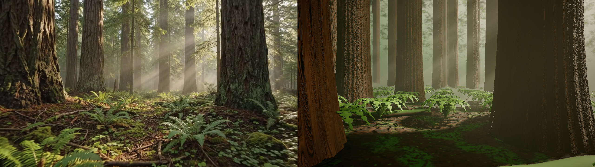
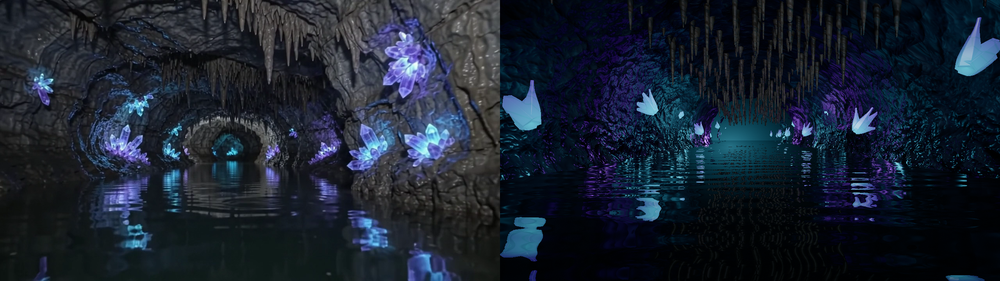

# Gemini Video 2 GLSL

A fun, unattended one-shot experiment showing what **Gemini 4 Carbon** (running on high) can build end-to-end from a single specification ([docs/spec.md](docs/spec.md)):

1. **Generate a 5-scene film** (Space, Forest, Ocean, Desert, Cavern) at 720p 16:9 using [`gemini-api`](https://github.com/google-gemini/gemini-api-cli) and cut the clips into a seamless 25-second looping film with cross-dissolves.
2. **Recreate the entire film as one procedural GLSL shader** — inspecting the generated video frames directly to match framing, camera trajectories, palettes, lighting, and dissolves in a single paste-ready Shadertoy fragment shader (`mainImage`, zero textures, zero baked data, real-time mouse orbit in every scene), built with [`shader-art-coding` (`gokayfem/shader-skills`)](https://github.com/gokayfem/shader-skills).
3. **Compare both live in the browser** with a minimal zero-dependency Side-by-Side and draggable Wipe player locked to the exact same 25-second timeline.

---

## Credits

- **Model:** **Gemini 4 Carbon** (running on high)
- **Tools:**
  - **[`gemini-api`](https://github.com/google-gemini/gemini-api-cli)** — CLI used to generate the five 720p 16:9 source video scenes.
  - **[`shader-art-coding` (`gokayfem/shader-skills`)](https://github.com/gokayfem/shader-skills)** (MIT) — provided the procedural shader workflow, WebGL2/Shadertoy lint and `glslangValidator` check harness, dependency-pruning bundler (`glsl_tools.py`), reference templates (`raymarch-sdf.glsl`, `ocean.glsl`, `terrain.glsl`, `volumetric-clouds.glsl`), and 18 bundled GLSL library modules (`common`, `hash`, `noise`, `pattern`, `sdf3d`, `operators`, `domain`, `raymarch`, `intersect`, `camera`, `shading`, `water`, `color`, `tonemap`, `volume`, `atmosphere`, `post`, `debug`). `LICENSE` and `CREDITS.md` are preserved in `shader-skills/`.

---

## Film vs. Procedural GLSL Stills (`1280×720` each)

Each pair shows the frame from `public/film.mp4` on the left and the live procedural GLSL shader frame at the exact same timestamp (`1280×720`, `AA = 1`, `DEBUG_MODE = 0`) on the right.

### Scene I — Space (`t = 02.00s`)


### Scene II — Forest (`t = 07.00s`)


### Scene III — Ocean (`t = 12.00s`)


### Scene IV — Desert (`t = 17.00s`)


### Scene V — Cavern (`t = 22.00s`)


---

## How to Run

Requires Node.js (no `npm install` — zero dependencies) and Python 3:

```bash
# Start the byte-range-capable local server at http://localhost:3000
npm start

# Re-bundle shaders/film.glsl into public/shader.glsl
npm run bundle

# Lint and compile-check shaders/film.glsl and public/shader.glsl
npm run check

# Bundle + check together
npm run build
```

Open `http://localhost:3000` (or set `PORT=8080 npm start`).

- **Side-by-Side / Wipe:** Switch between dual 16:9 panes (Film left, GLSL right) and a stacked 16:9 frame with a draggable wipe divider.
- **Transport & Scene Jumps:** Play/Pause (`Space`), scrub across `00:00.0 – 00:25.0`, or click **I Space** … **V Cavern** (or any of the five **Original Videos** cards) to jump straight to a scene.
- **Mouse Orbit:** Drag on the shader to orbit its 3D camera around any scene; click **Reset Orbit** to return to the film-locked camera path.

---

## Scene-by-Scene Notes

- **I · Space (`00s – 05s`):** Matches planet framing (`uv ≈ (-0.72, 0.04)`), cream/ochre/rust belts, southern oval storm vortex, terminator, sleek ring ellipse with outer Cassini-like division, right-side ring shadow wedge, violet cosmic filaments, pinpoint starfield, and upper-right sun streak. *Simplified:* Separates planet key-light direction from the ring-shadow cylinder to match the video's visual art direction, and renders foreground ring debris as 2D Voronoi speckles on the ring plane rather than 3D boulders.
- **II · Forest (`05s – 10s`):** Matches low forward corridor glide between close flared redwood trunks, vertical bark ridges, ~40° diagonal morning sunbeams through mist, layered backlit canopy foliage, mossy logs, and sun-dappled fern clumps. *Simplified:* Ferns are single-cell 13-blade polar SDF rosettes rather than dense individual botanical leaflets, overhead canopy boughs use three depth-parallax layers, and fine bark/floor relief uses post-hit normal perturbation.
- **III · Ocean (`10s – 15s`):** Matches exact horizon (`uv.y = +0.119`), jagged dark sea stack and masonry lighthouse proportions, glowing lantern (`uv ≈ (0.13, 0.59)`), rotating warm searchlight beam across storm clouds, deep-teal swells, lacy foam networks, and white surf runnels on wet rock. *Simplified:* Uses a single-valued dispersive exp-sine wave heightfield plus domain-warped foam masks rather than multi-valued overturning 3D wave tubes and particle spray.
- **IV · Desert (`15s – 20s`):** Matches Delicate-Arch-like sandstone arch silhouette (narrow left ankle, broad right pier, flat layered cap), left-edge stepped sandstone butte, right canyon bluff, hazy mesa plateau across the horizon and inside the arch window, deep blue sky gradient, and golden-hour orange sand ripples. *Simplified:* Uses smooth Lipschitz-safe asymmetric dune spines with footprint-filtered ripple normals rather than sharp slumped slip-faces.
- **V · Cavern (`20s – 25s`):** Matches water-level river glide down a curving arched limestone vault, waterline (`uv.y ≈ -0.16`), hanging stalactite curtains, glowing violet/cyan wall crystal clusters, distant turquoise grotto glow, and rippled vertical crystal reflections in dark water. *Simplified:* Models crystal clusters from 5 tapered hexagonal prisms with Voronoi cleavage and exponential core-to-tip emission rather than multi-bounce internal refraction, and traces 32-step coarse reflections.

---

## Performance, Validation & Notes

- **Measured Frame Rate (`1280×720`, `AA = 1`, `DEBUG_MODE = 0` on Apple M3 Pro WebGL2):**
  - **Live playback (`requestAnimationFrame`):** **59.4 fps** across the full 25-second loop (60 Hz display-locked).
  - **Uncapped synchronous GPU execution (`gl.readPixels` fence):** **281.3 fps** (Space), **40.1 fps** (Forest), **123.2 fps** (Ocean), **56.7 fps** (Desert), **46.3 fps** (Cavern); **33.5 – 42.7 fps** across four `0.75s` cross-dissolves and **27.8 fps** during the `0.75s` Desert → Cavern dual-raymarch dissolve.
- **Shader Validation:** `glsl_tools.py check` with `glslangValidator` compiled both `shaders/film.glsl` and `public/shader.glsl` cleanly with **`0 error(s), 0 warning(s)`**.
- **Unattended Decisions & Limitations:**
  - Source clips (`10.03s`, `1280×720`, 24 fps) were trimmed to `5.75s` windows and joined with `0.75s` linear cross-dissolves (`24.25s – 25.00s` dissolves Scene V seamlessly back into Scene I's `0.00s` frame for an exact 600-frame `25.000s` loop).
  - During the `0.75s` Desert → Cavern dissolve, evaluating both raymarched scenes dips synchronous `readPixels` frame rate briefly to `~27.8 fps`.
  - Automated inspection and benchmarks ran via headless hardware-accelerated WebGL2 rather than physical monitor/speaker playback.
  - Because Shadertoy provides no custom uniforms, cumulative drag-orbit on the page maps onto `iMouse`; on Shadertoy.com itself, clicking away from center applies that `iMouse.xy` offset immediately.
